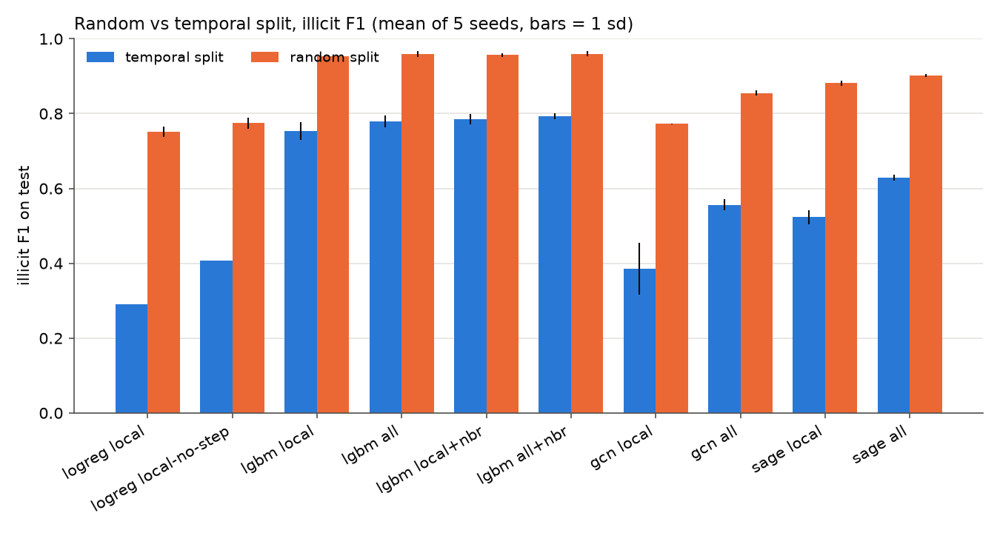
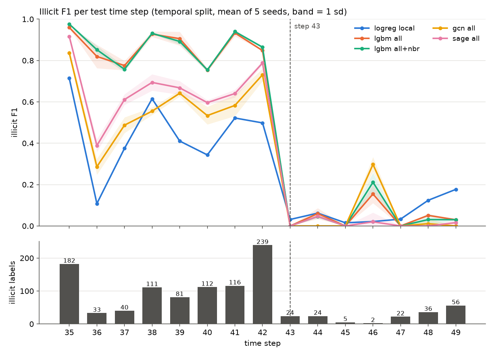

# aml-graph-split

I wanted to check two things on the Elliptic Bitcoin dataset. Do graph neural networks beat plain tree models at spotting illicit transactions? And how much does a random train/test split flatter the results compared with a split by time?

**Main finding:** under an honest time-based split, LightGBM beats a 2-layer GCN and GraphSAGE by about 0.16 illicit F1 (0.79 vs 0.63), and a random split inflates every model's F1 by 0.17 to 0.46.

## Data

The [Elliptic dataset](https://www.kaggle.com/datasets/ellipticco/elliptic-data-set) (Weber et al., 2019): 203,769 Bitcoin transactions over 49 time steps, linked by 234,355 payment-flow edges. 4,545 transactions are labelled illicit, 42,019 licit, and the remaining 157,205 are unlabelled. Each node has 166 features: the time step, 93 other local features, and 72 features Elliptic aggregated over neighbours.

No edge crosses a time step, so each step is its own graph. That means training on the full graph can't leak anything from the test period into training nodes.

## Setup

- **Temporal split (main result):** fit on steps 1-29, validate on 30-34 for early stopping and for picking the decision threshold, test on 35-49. This follows Weber et al., who train on 1-34 and test on 35-49.
- **Random split:** stratified random split of labelled nodes, with the same train/val/test sizes (26,381 / 3,513 / 16,670).
- Unlabelled nodes stay in the graph for message passing but never count in the loss or the metrics.
- Models: logistic regression; LightGBM on local features, on all features, and on each with neighbour-averaged local features added; 2-layer GCN; 2-layer GraphSAGE. The GNNs run on local and on all features.
- 5 seeds per model. Illicit F1 uses a threshold picked on validation, never on test. Also AUPRC and F1 per test time step.

## How to run

```
python -m venv .venv
.venv/Scripts/pip install -r requirements.txt   # .venv/bin/pip on Linux/Mac
python 01_load_data.py      # downloads Elliptic via torch_geometric, builds arrays and splits
python 02_baselines.py      # logistic regression and LightGBM (about 55 min here, sharing the CPU with 03)
python 03_gnn.py            # GCN and GraphSAGE, uses CUDA if available (about 1 h on a GTX 1660 Ti)
python 04_make_figures.py   # results/main_table.csv and figures/
jupyter nbconvert --to notebook --execute --inplace results.ipynb
```

If the PyG download fails, put `elliptic_txs_features.csv`, `elliptic_txs_classes.csv` and `elliptic_txs_edgelist.csv` from Kaggle in `data/raw/elliptic/`.

## Results

Illicit F1 and AUPRC on the test set, mean ± sd over 5 seeds. `local` = 94 features, `all` = 166, `+nbr` = plus the mean of the neighbours' local features. Full numbers are in `results/main_table.csv`.

| model | temporal F1 | temporal AUPRC | random F1 | random AUPRC | F1 gap |
|---|---|---|---|---|---|
| logreg local | 0.291 ± 0.000 | 0.173 | 0.752 ± 0.013 | 0.672 | 0.461 |
| logreg local, no time step | 0.408 ± 0.000 | 0.196 | 0.775 ± 0.015 | 0.673 | 0.367 |
| LightGBM local | 0.754 ± 0.024 | 0.782 | 0.953 ± 0.003 | 0.987 | 0.199 |
| LightGBM all | 0.779 ± 0.017 | 0.792 | 0.959 ± 0.007 | 0.989 | 0.180 |
| LightGBM local+nbr | 0.785 ± 0.015 | 0.795 | 0.957 ± 0.005 | 0.988 | 0.172 |
| LightGBM all+nbr | **0.793 ± 0.008** | **0.796** | 0.960 ± 0.007 | 0.989 | 0.167 |
| GCN local | 0.385 ± 0.069 | 0.414 | 0.773 ± 0.001 | 0.845 | 0.388 |
| GCN all | 0.556 ± 0.015 | 0.503 | 0.855 ± 0.007 | 0.925 | 0.299 |
| GraphSAGE local | 0.523 ± 0.019 | 0.546 | 0.882 ± 0.007 | 0.941 | 0.358 |
| GraphSAGE all | 0.629 ± 0.009 | 0.639 | 0.902 ± 0.004 | 0.952 | 0.273 |

Logistic regression has zero spread on the temporal split because it's deterministic and the split doesn't change between seeds.



What I took from it:

- **The GNNs don't beat LightGBM under the temporal split.** LightGBM on all features beats the best GNN on every seed, by 0.11 to 0.16 F1.
- **The random split inflates everything, and the GNNs most.** LightGBM gains 0.17-0.20 F1, the GNNs 0.27-0.39. Under a random split, a test node's neighbours are often in the training set, which a GNN uses directly. The random split also shrinks the LightGBM-vs-GraphSAGE gap from 0.16 to 0.06.
- **Neighbour-averaged features help LightGBM a little** (+0.031 F1 on local features, +0.014 on all). That's the cheap way to get most of what the graph adds here.
- **Logistic regression is hurt by the time step feature.** Under the temporal split, it's outside its training range for every test node, and a linear model extrapolates it. Dropping it lifts F1 from 0.29 to 0.41. I made that call on validation; see NOTES.md.

### Compared with Weber et al. (2019)

Their Table 1 reports illicit F1 on the same test steps: logistic regression 0.457 (local) / 0.481 (all), random forest 0.788 (all) / 0.796 (all + GCN embeddings), GCN 0.628, Skip-GCN 0.705, and EvolveGCN 0.720 in their Table 2. My LightGBM (0.779 all, 0.793 all+nbr) lands close to their random forest. My GCN on all features is lower (0.556 vs 0.628); they train on steps 1-34 and use a 100-unit hidden layer, a 0.001 learning rate and 1000 epochs, and I fit on 1-29 with one untuned setting. Their own conclusion was the same as mine: the tree model beats the GCN.

### Per time step, and what happens after step 43



Every model does reasonably from step 35 to 42 and then drops to almost zero F1 from step 43 to 49. The number of illicit labels falls from 239 at step 42 to 24, 24, 5 and 2 at steps 43-46, then rises again to 22, 36 and 56 at 47-49. Recall stays near zero even at 47-49, so the drop isn't only about there being fewer illicit nodes to find.

To see why, I looked at each test node's 10 nearest labelled training nodes (steps 1-34) in local-feature space:

| test nodes | illicit share among 10 nearest training nodes |
|---|---|
| illicit, steps 35-42 | 0.79 |
| illicit, steps 43-49 | 0.07 |
| licit, steps 35-42 | 0.05 |
| licit, steps 43-49 | 0.06 |

After step 43, illicit transactions look like licit ones by every pattern seen in training. Weber et al. attribute the drop to "the sudden closure of a dark market" at step 43. What the data itself shows is consistent with that: the illicit patterns the models learned stop appearing, and the illicit nodes that remain look different. But the data is anonymised, so I can't confirm the cause from it. `results.ipynb` walks through this.

## Limitations

- One dataset, one temporal cut. The test period contains the step-43 break, which every model fails on, so the absolute F1 numbers depend heavily on where the cut falls.
- I didn't tune hyperparameters beyond early stopping. The GNNs use one standard setting (64 hidden units, dropout 0.5, Adam at 0.01, loss weight 0.7/0.3 as in Weber et al.). A tuned or deeper GNN, or a temporal one like EvolveGCN, might close some of the gap. I didn't try, to avoid tuning against the test period.
- All models fit on steps 1-29 and use 30-34 only for validation. Refitting on 1-34 would use more recent data and might score a bit higher.
- Edges are treated as undirected for the GNNs and the neighbour means.
- The threshold is picked on a validation period with 16.8% illicit and applied to a test period with 6.5%, which is realistic but costs F1.
- GNN runs on CUDA gave identical results on repeat in my checks, but GPU scatter operations aren't guaranteed to be bit-for-bit deterministic.

## References

- Weber, M., Domeniconi, G., Chen, J., Weidele, D. K. I., Bellei, C., Robinson, T., Leiserson, C. E. (2019). Anti-Money Laundering in Bitcoin: Experimenting with Graph Convolutional Networks for Financial Forensics. KDD Workshop on Anomaly Detection in Finance. arXiv:1908.02591.
- Kipf, T. N., Welling, M. (2017). Semi-Supervised Classification with Graph Convolutional Networks. ICLR.
- Hamilton, W. L., Ying, R., Leskovec, J. (2017). Inductive Representation Learning on Large Graphs. NeurIPS.
- Ke, G. et al. (2017). LightGBM: A Highly Efficient Gradient Boosting Decision Tree. NeurIPS.
- Fey, M., Lenssen, J. E. (2019). Fast Graph Representation Learning with PyTorch Geometric. ICLR Workshop on Representation Learning on Graphs and Manifolds.
